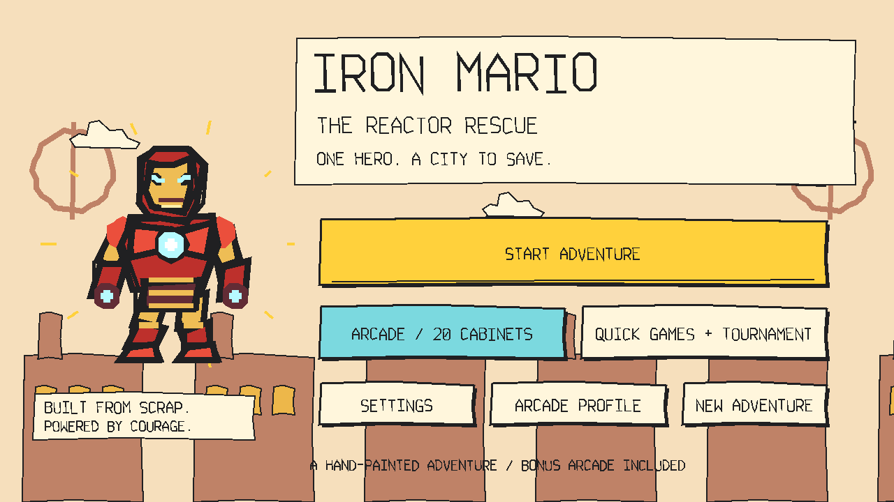
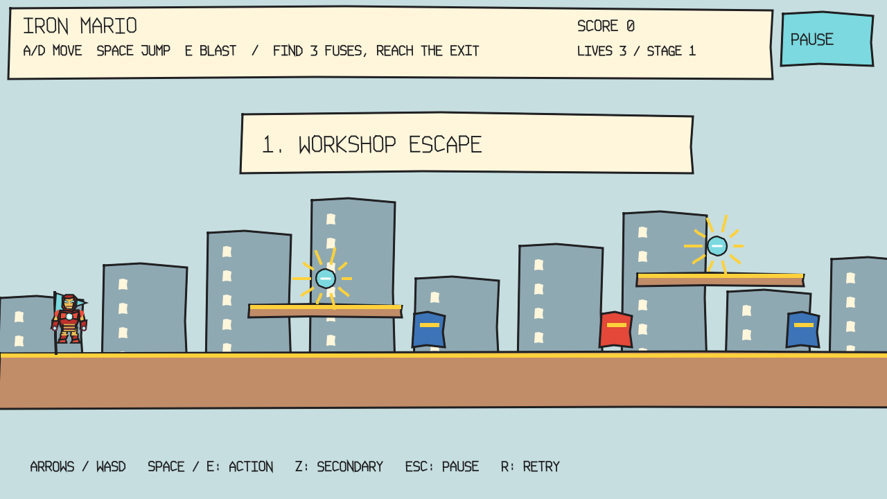
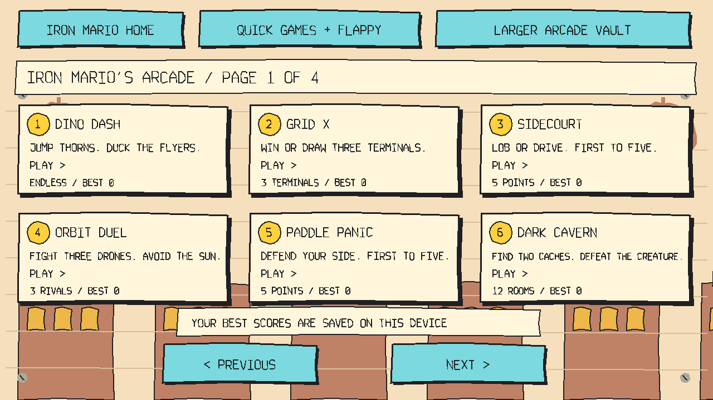
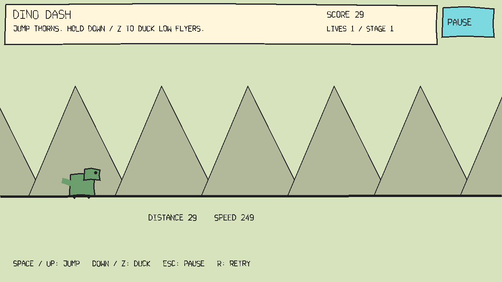
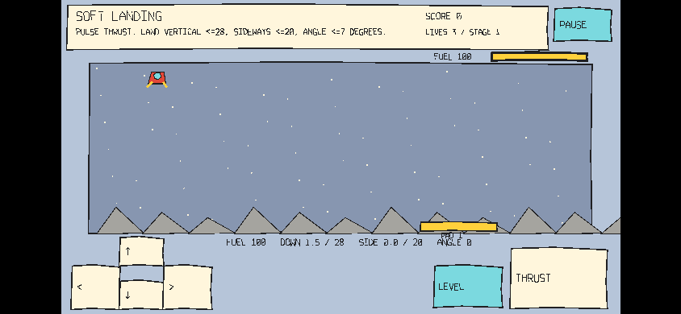

# IRON-MARIO: The Reactor Rescue

Iron Mario is an original red-and-gold armored hero who jumps, blasts scrap robots, restores the city relays, and takes on the Scrap King in a handmade MS Paint-style adventure.

[Play in your browser](https://hustlenix.github.io/Iron-Mario/) · [Active source branch](https://github.com/Hustlenix/Iron-Mario/tree/classic-seven-games)



The Home, arcade library, Dino Dash and phone landing images are actual screenshots of the exported Godot game captured in Chromium. The workshop image is a rendered preview of Godot drawing commands.

## Start playing

Choose **START ADVENTURE** on Home. Saved stage progress changes this to **CONTINUE ADVENTURE**. **NEW ADVENTURE** starts at the workshop; existing arcade records remain intact.

For Windows, extract the entire build ZIP and launch `Iron-Mario.exe` with its `.pck` beside it. GitHub Actions packages retain the historical `Super-Micro-Heroes.exe` filename; both builds show the IRON-MARIO title.

From source, open `project.godot` in Godot **4.4.1**, then press F5. The main scene is `res://scenes/title_screen.tscn`. The core game avoids features newer than 4.4. The optional preserved Vault uses its own Godot 4.7.1 export.

## The core adventure

Iron Mario is always the protagonist. Arcade character preferences do not replace him in the story.

1. **Workshop Escape:** learn movement, collect three fuses, and blast or jump on patrol robots.
2. **Skyline Relay:** cross gaps on gently moving bridges, reach raised relays, and watch turret warning lights.
3. **The Molten Works:** navigate lava gaps and steam vents that flash before erupting.
4. **The Scrap King:** dodge telegraphed ground pulses, exploit the exposed core, and survive escalating attacks.

Movement has acceleration, air control, jump buffering, coyote time, and short hops when Jump is released. Iron Mario has breathing, running, jumping, blaster, damage, and victory poses. Each stage has a checkpoint; cleared-stage progress is saved. Falling costs a hull and returns to the current checkpoint. Three lost hulls offer a retry of the saved stage. The ending celebrates the restored reactor; failure powers the suit down.



## Controls

| Mode | Keyboard / mouse | Phone |
|---|---|---|
| Adventure movement | A/D or arrows | Left thumb on movement pad |
| Adventure jump | W / Up / Space; release for short hop | Right JUMP button |
| Adventure blast | Hold E / Enter | Right BLAST button |
| Arcade directions | Arrows / WASD | Direction pad; direct dragging where supported |
| Arcade primary | Space / E / Enter | Large labelled action button |
| Arcade secondary | Z / U | Secondary button when needed |
| Paddle games | Move keys or mouse position | Drag paddle |
| Grid X / Sky Shield | Click a cell / interception point | Tap directly |
| Pause | Escape | PAUSE button |
| Retry | R | PLAY AGAIN after result |
| Return Home / Arcade | Pause, then Home / Arcade | Same pause menu |

Phone play is landscape. Turning upright or losing app focus pauses the game and clears held inputs. Controls support simultaneous two-finger input. Physical phone hardware testing is still needed; automated browser checks use mobile emulation.

## Optional arcade: twenty cabinets

Choose **ARCADE** from Home. All twenty games are available immediately, in four pages with objectives, per-game records, and replay controls. Each opens a short briefing with its own keyboard and phone controls. Press **Space / Enter** or tap **PLAY** when ready; gameplay stays frozen until then. Their lives, scores and timing are independent of the seven-game Tournament.

On phones, the action button changes to **NEXT**, **RETRY PAD** or another suitable label between rounds. Tapping the playfield also continues a cleared round. Flag Run steers continuously toward a held finger; lifting it stops steering. Byte Munch uses the direction pad or directional dragging without an unused action button. Pause shows the game's controls again; Enter/Space resumes or replays a result.



| Cabinet | Goal / progression |
|---|---|
| Dino Dash | Endless jump-and-duck runner; first three obstacles are small ground thorns |
| Grid X | Three tic-tac-toe terminals: exploring AI, wins/blocks AI, then minimax AI; win or draw advances |
| Sidecourt | Side-view gravity tennis; lob/drive shots; two bounces lose the point; first to five |
| Orbit Duel | Turn, thrust, brake and fire under solar gravity; defeat three rival drones |
| Paddle Panic | Paddle position shapes return angles; first to five |
| Dark Cavern | Twelve linked rooms, clue-based hazards, three bolts, two caches, return to entrance |
| Armored Arena | Three wall-filled tank arenas; directional gun, enemy firing warnings, three hulls |
| Brick Burst | Endless brick waves; tougher layouts, edge aiming, WIDE/SLOW chips and three balls |
| Byte Munch | Endless snake with turn buffering, growing trail and warned obstacle posts |
| Invader Patrol | Three descending robot formations; destructible barriers repair between waves |
| Rock Drift | Three inertial debris fields; large rocks split into smaller threats |
| Soft Landing | Three pads; downward speed <=28, sideways speed <=20, angle <=0.13 radians; fuel and three hulls |
| Flag Run | Six flags and return to exit in each of three districts; smoke costs exactly 12 fuel |
| Dot Gobbler | Two original mazes; buffered turns, seven-second power crystals, collected dots survive damage |
| Sky Shield | Three missile waves; limited ammunition, expanding blasts and chain reactions |
| Bug Blaster | Three garden waves; mushrooms block shots and redirect advancing bugs |
| Hopway | Four home bays across three rounds; traffic, rideable logs, crossing timer and four lives |
| Color Steps | Three diagonal-hopping pyramids; final pyramid needs two coats; one recall per pyramid |
| Crate Shift | Five original push-only crate rooms; undo; all rooms verified solvable |
| Stackfall | Seven-piece bag, rotation and wall kicks, ghost, soft/hard drops; clear 24 rows |

**Rockfall Mines** remains a future proposal; it has no playable cabinet yet.





## Existing games and the larger Vault

**QUICK GAMES + TOURNAMENT** retains Arc Reactor Dash, Target Lock, Laser Tunnel, Reactor Parry, Armor Repair, Rocket Rescue and Power Core Sequence. Each remains individually playable. Tournament keeps its five reactor lives, random seven-game order, streak scoring, winner/death scenes and harder loops. Bonus Flappy retains its medals, shield pickups and saved best score.

The nine original arcade hero choices, profile, settings and soundtrack remain available. The Ember Rig profile display name is now **Iron Mario**, using the same stable saved ID `ember`.

**LARGER ARCADE VAULT** preserves the existing 105-game project as a separate optional Web export at `extended-arcade/`, with a visible return link to Iron Mario. Its source is pinned to `dee29ae9d8ce1e66eafbb84dc9eaa8db3d530359` on the preserved main history. The core homepage stays focused on Iron Mario. The Vault retains its own art, credits and save system; its existing limitations are recorded in that source version's README.

## Godot architecture

| Component | Responsibility |
|---|---|
| `Global.gd` | Existing saves/settings; separate arcade records and adventure stage/clear fields |
| `GameManager.gd` | Existing Tournament state and deferred scene navigation |
| `AdventureMotor.gd` | Adventure movement, jump buffering, coyote time and variable jump height |
| `IronAdventure.gd` | Authored stages, collectibles, checkpoints, enemies, steam vents, boss phases and endings |
| `ArcadeGameBase.gd` | Shared input, two-finger ownership, pause, HUD, records, results and cleanup |
| `ArcadeCatalog.gd` | Twenty stable cabinet IDs and metadata |
| `ReflexGames.gd` | Runner, paddle, tennis and brick-ball simulation |
| `BoardGames.gd` | Grid/maze logic, puzzle rooms, AI and falling blocks |
| `SpaceGames.gd` | Gravity, inertia, rock splitting and landing |
| `ActionGames.gd` | Tanks, robots, driving, missiles and garden waves |
| `MiniGameBase.gd` | Existing short-game timer and Tournament result signals |
| `Paint.gd` / `IronHero.gd` | Original irregular outlines, flat fills, letter strokes and hero poses |

The game keeps one `Global` state holder. Arcade sessions do not award Tournament clears or alter its records. Saves use the existing custom data directory and `iron_mario_save.cfg`. New fields default safely for old profiles. The preserved Vault has an independent runtime.

## Original assets and audio

The core adventure and twenty new cabinets use original Godot drawing code: solid fills, deliberately uneven outlines, simple silhouettes, hand-lettered glyphs and no smooth 3D rendering. Existing original SVGs and synthesized sound effects are reused. Original hero music adds a faster boss mood and victory transition. No official franchise artwork or film soundtrack is included. The optional historical Vault retains its own documented asset credits and licenses.

## Verification and export

```sh
godot --path .
python tools/solve_warehouses.py
python tools/validate_project.py
python tools/check_engine.py /absolute/path/to/godot
```

The source suites pass **335 assertions** on official Godot 4.4.1: 82 existing gameplay checks, 51 profile/touch checks, and 202 adventure/cabinet checks. The new suite covers all twenty frozen briefings and start inputs, legal puzzle inputs, scoring boundaries, touch continuation, drag-rate-independent driving, undo score restoration, save reloads, all three authored traversal paths and a boss pilot using legal movement/shots with three hulls. All 46 scenes also launch without engine errors. The crate solver independently searches all five room layouts.

GitHub Actions validates and exports the core with Godot 4.4.1, launches source and native packages on Windows, and exercises the exported game in Chromium. Browser checks open all twenty cabinets, exercise adventure keyboard/two-finger input, pause and orientation, preserved Flappy, and the separate Vault. Actual phone/speaker/GPU combinations are outside automated coverage.

Install the matching official templates, then:

```sh
mkdir -p build/windows build/linux build/web
godot --headless --path . --export-release "Windows Desktop" build/windows/Super-Micro-Heroes.exe
godot --headless --path . --export-release Linux build/linux/Super-Micro-Heroes.x86_64
godot --headless --path . --export-release Web build/web/index.html
python tools/prepare_classic_web.py
```

The deployment workflow also exports the pinned larger arcade with Godot 4.7.1, places it under `extended-arcade/`, and publishes both after required checks pass. A local core-only export does not bundle that optional Vault.

## Development log, credits and AI use

See [DEVELOPMENT_LOG.md](DEVELOPMENT_LOG.md) for the planned schedule and honest update notes. No untracked coding hours are claimed as completed.

Godot Engine powers the game. The rapid microgame format takes inspiration from WarioWare; the new cabinets use familiar arcade genres with original names, layouts and artwork. The original project and its accumulated arcade work are retained in Git history and the optional Vault.

AI assisted the implementation, drawing code, original synthesized audio, documentation and automated checks. These are programmatic artworks designed to resemble handmade MS Paint drawings, not a claim that every asset was manually painted in Microsoft Paint.
