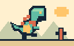

# IRON-MARIO → ONLYEDUCATION

Bringing childhood gaming back, one pixel at a time.

This started as Iron-Mario. Now I am shaping it into **OnlyEducation**, my nostalgic pixel-game platform under **Hustlenix**.

My idea is simple: bring back that feeling of opening a browser, finding a random game, and somehow spending way too long on it🤣. Original little games, chunky pixels, and that “one more try” feeling.

**[Play](https://hustlenix.github.io/Iron-Mario/arcade/)** · **[Original Godot arcade](https://hustlenix.github.io/Iron-Mario/legacy.html)** · **[Development branch](https://github.com/Hustlenix/Iron-Mario/tree/codex/onlyeducation-history-arcade)**



## What is in it?

The current development build has **20 playable games**. There are puzzles, racing, court games, space battles, a landing game, and a dinosaur running around **67 million years ago**. Bro picked a bad time to go for a run💔.

The latest six are **Orbit Duel, Armored Arena, Invader Patrol, Soft Landing, Dot Gobbler, and Bug Blaster**. Rockfall Mines is still on the workbench.

You can search games, save favorites, return to recently played games, and keep your best scores on your device. No mandatory account. Keyboard and touch controls are shown inside each game. Press **G** to switch games, **P** to pause, and **R** to restart.

## Wait, which version am I playing?

As checked on **18 October 2026**, the public website has **14 games**. The source branch has the **20-game beta**. Pushing code to GitHub does not automatically mean that the website got updated too.

I want some actual play feedback before publishing the beta. Automated tests cannot tell me whether you had fun. That part is on us✌🏻.

The older **105-game Godot arcade** is preserved separately. I did not turn that into 105 finished games in the new browser catalog. They are two different parts of this project.

## Does it work?

“Trust me bro” is not the test suite, so here is the actual checkpoint:

- **179** rule, engine, input, and save/library tests passed.
- **100** local browser checks passed across the 20 games.
- **23** platform checks passed, including storage failures, loading errors, fullscreen, and responsive controls.

Those are automated checks. **They are not 100 player reviews.** Physical-device testing and real play feedback still matter.

See [the 20-game beta evidence](docs/arcade/TWENTY_GAME_BETA.md) and [what still needs testing](docs/arcade/PLAYTESTING.md).

## Run it yourself

For the new browser arcade, you need **Node.js and Python**. Godot is needed for the original Godot game, not for this Canvas arcade.

From the repository root:

```sh
node --test tests/arcade/*.test.mjs
python tools/package_arcade.py
python -m http.server 8785 --bind 127.0.0.1 --directory build/web
```

Then open **http://127.0.0.1:8785/arcade/**. Keep that server terminal running while you play.

For the original game, open `project.godot` in **Godot 4.7.1**, using the Compatibility renderer. Its code and scenes are still here.

## How I am building it

I use AI coding tools to help write, debug, and test things. I direct the idea and keep changing the parts that feel wrong. There have been a lot of those parts, man🤣.

The newer arcade uses **HTML, CSS, JavaScript, and Canvas**. Each game has its own module in `onlyeducation/arcade/games/`; the shared engine handles input, sound, pause, restart, and cleanup.

The original Iron-Mario side uses **Godot**. The shared pixel-art sources live in `source_art/history_arcade/`, and the reusable exports are in `assets/shared_foundation/history_arcade/`.

## Art and licenses

The new arcade uses original project pixel art, Canvas drawings, and synthesized sounds. Some shared artwork has editable Aseprite sources. The gameplay thumbnails are captures of the actual games.

I also have asset packs such as **Modern Interiors by LimeZu** for the wider project. Owning a pack does not mean its raw files can be uploaded for everybody to download. Those source packs and private studies are excluded from the new arcade package.

See the [arcade asset register](docs/arcade/ASSETS.md) and the [wider project license notes](docs/ASSET_LICENSES.md). This README does not give permission to redistribute third-party packs.

## Build and release

GitHub stores the source. GitHub Pages serves the public arcade from the `gh-pages` branch. They are separate steps; the development branch does not auto-deploy.

The packaging and deployment process is in [DEPLOYMENT.md](docs/arcade/DEPLOYMENT.md). The 20-game publisher checks for recorded human play observations before releasing it.

My plan is to keep making this better, one game at a time. Try a game and tell me the single most annoying thing about it. That is more useful than just saying “nice game.”

Enjoy the pixels. Try to beat your own score. And yes, I am gonna keep working on this✌🏻.
